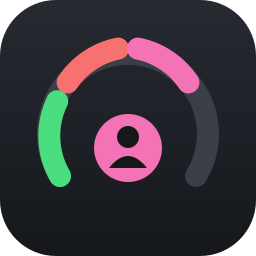

<div align="center">



# Switchboard for Claude Code

**Several Claude Code accounts. One editor. Always know how much you have left.**

Switch accounts per window or per repository, and see each account's 5-hour and 7-day plan limits right in the status bar.

</div>

---

## Why Switchboard

|  |  |
| --- | --- |
| **One account per window** | Work and personal side by side, in two windows, at the same time. |
| **Remembers each repo** | Open a repository and its account is applied for you. |
| **Plan limits at a glance** | 5-hour and 7-day usage for every account, before you hit the wall. |
| **Your `~/.claude` stays untouched** | It becomes the *Default* account and is never moved, deleted or overwritten. |

## Get started in a minute

1. Click **Claude: default** in the status bar → **Add account…**
2. Name it and choose a profile:
   - **Shared**: reuses your settings, `CLAUDE.md`, agents, skills and plugins and keeps its own login.
   - **Isolated**: everything separate.
3. Choose **Log in**. A terminal opens and runs `claude auth login` for that account.
4. Switch any time from the status bar. The window reloads so Claude Code picks up the change.

> Run `/status` in the Claude Code panel to confirm which account is active.

## Features

**Accounts**
- Per-window accounts that run at the same time
- Default account per repository, keyed by its git remote, so every clone shares it
- Rules: every repo under `~/work/**`, or from `github.com/my-company/*`, uses a given account
- Quick toggle between the last two accounts: `Ctrl+Alt+Shift+A` (`Cmd+Alt+Shift+A` on macOS)
- The integrated terminal's `claude` CLI uses the same account as the panel

**Usage**
- 5-hour and 7-day plan limits per account, in the status bar, tooltip and picker
- Tokens used today, over 7 and 30 days and all time, with what it would cost at API prices. Daily totals are kept, so the history outlasts Claude Code's log cleanup.
- When you hit a limit, Switchboard offers to switch to another account in one click

**Artifacts from any account**
- A claude.ai artifact opens only in a browser logged into the account that published it. Switchboard previews artifacts that Claude Code publishes from local files on `http://127.0.0.1:4999`, from every account, with no login and live reload. Design canvases show their boards: pan, zoom, fit.
- Each new artifact opens in the local preview by itself (or, with `artifactPreviewAutoOpen` off, a notification offers it). All of them are listed in **More > Artifacts**.

**Personal touch**
- E-mail, plan (e.g. Pro, Max 20x) and organization for each account
- Own color, icon or emoji, and optional picture per account
- Per-account environment variables, such as a default model or proxy, kept locally
- Settings Sync carries names, colors and repo defaults to your other machines. Logins stay local.

## Settings

| Setting | Default | What it does |
| --- | --- | --- |
| `claudeAccounts.scope` | `workspace` | `workspace`: each window or repo remembers its account. `user`: one account everywhere. |
| `claudeAccounts.accountsRoot` | `~/.claude-accounts` | Where account folders live. |
| `claudeAccounts.sharedItems` | settings, CLAUDE.md, agents… | What shared-profile accounts reuse from `~/.claude`. |
| `claudeAccounts.shareHistory` | `false` | Shared conversation history. Change it with the **Share history** command so existing history is merged. |
| `claudeAccounts.historyItems` | projects, history.jsonl… | What counts as history. |
| `claudeAccounts.autoApplyRepoDefault` | `true` | Apply the repository's account when it opens. |
| `claudeAccounts.reloadBehavior` | `always` | Reload after switching: `ask`, `always` or `never`. A reload closes the open Claude Code conversation and terminals. |
| `claudeAccounts.planLimits` | `true` | Show the 5-hour and 7-day plan limits. |
| `claudeAccounts.applyToTerminal` | `true` | Use the account in integrated terminals too. |
| `claudeAccounts.loginCommand` | `claude auth login` | Command used to log in. |
| `claudeAccounts.statusBarStyle` | `name` | `name`, `initials` or `icon`. |
| `claudeAccounts.showPlan` | `true` | Show the plan name. |
| `claudeAccounts.rules` | `[]` | Default-account rules, see below. |
| `claudeAccounts.artifactPreview` | `true` | Local artifact preview. |
| `claudeAccounts.artifactPreviewAutoOpen` | `true` | Open each new artifact's preview automatically. |
| `claudeAccounts.artifactPreviewPort` | `4999` | Port of the preview. |
| `claudeAccounts.suggestSwitchOnLimit` | `true` | Offer a switch when you hit a limit. |
| `claudeAccounts.gravatar` | `false` | Gravatar pictures in the picker. |

<details>
<summary><b>Rules</b></summary>

Rules are checked in order for any repository without its own default:

```json
"claudeAccounts.rules": [
  { "pattern": "github.com/my-company/*", "account": "work" },
  { "pattern": "~/personal/**", "account": "Personal" }
]
```

A pattern that starts with `~`, `/` or a drive letter matches the folder path. Anything else matches the git remote. `*` matches one segment and `**` matches any depth. `account` is the account's id or its name.

</details>

<details>
<summary><b>How it works</b></summary>

Claude Code reads its configuration folder from `CLAUDE_CONFIG_DIR`. Each account is a folder under `~/.claude-accounts/`. Switchboard sets that variable for the window, and for its terminals, before Claude Code starts. That is why it activates on startup.

Shared items are links. On Windows, folders use junctions, which need no admin rights.

</details>

<details>
<summary><b>Known limitations</b></summary>

- Don't set `CLAUDE_CONFIG_DIR` in `claudeCode.environmentVariables`. It overrides switching everywhere. Switchboard detects this and offers to remove it.
- If `/status` shows the wrong account right after startup, reload the window once.
- If a tool replaces a shared file instead of editing it, the link breaks. Switchboard offers **Relink** and keeps a `.bak` copy.
- On macOS, logins live in the Keychain, so the plan may not show.
- The artifact preview shows files as they are on disk. Dynamic parts of design pages (loops, conditions, imports) are simplified, files uploaded to claude.ai are not shown, and artifacts in a session scratchpad disappear when Windows cleans its temp folder.
- Plan limits, usage and artifact detection rely on undocumented Claude Code formats and may break after updates.

</details>

## Privacy

- **No telemetry.** Nothing is collected about you.
- **Plan limits.** To read your limits, Switchboard takes the account's Claude Code login token from `.credentials.json` and asks `api.anthropic.com` for the account's usage, the same way Claude Code's `/usage` does. No tokens are used. Only if that fails does it fall back to a one-token request, whose response headers carry the limits. The login token goes only to Anthropic and is never stored or shown. Turn this off with `claudeAccounts.planLimits`.
- **Artifact preview.** The preview server listens only on 127.0.0.1 and accepts only requests addressed to 127.0.0.1 or localhost. It serves just the folders of published artifacts, never hidden files such as `.env`.
- **Gravatar** (off by default) sends a SHA-256 hash of the account's e-mail to gravatar.com.

## Requirements

- VS Code 1.85+, or Cursor, VSCodium or Windsurf
- The official Claude Code extension

## Credits

Switchboard is a fork of **[Multi-Account Switcher for Claude Code](https://github.com/Kahuecosta/account-switcher-for-claude-code)** by Kahuê Costa, who built the account switching. The plan-limit display was inspired by **[Claude Status](https://github.com/long-910/vscode-claude-status)** by Small Long and **[Claude Code Usage Bar](https://github.com/smanettu/vscode-claude-usage)** by Vincenzo Vitale. Thank you all.

## License

[MIT](LICENSE.txt). The license file keeps the original copyright notices.

<sub>Switchboard is a community project and is not affiliated with or endorsed by Anthropic. "Claude" and "Claude Code" are trademarks of Anthropic, PBC.</sub>
